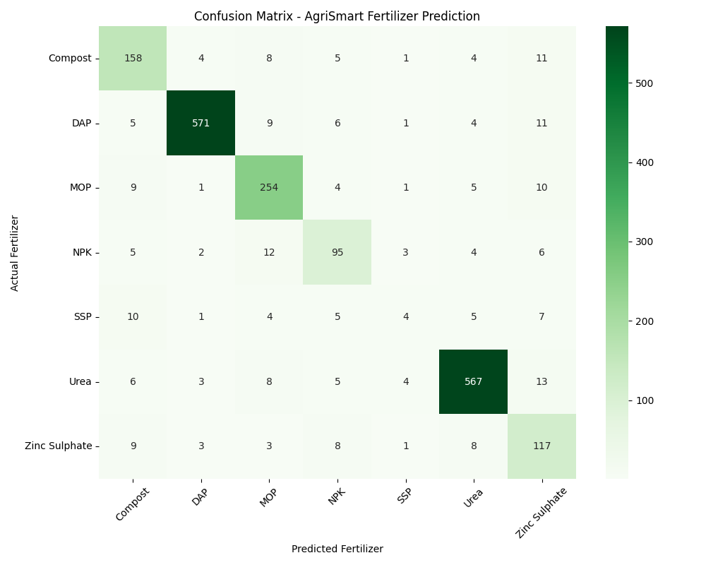

# 🌱 AgriSmart – Fertilizer Prediction System

## 📌 Project Overview

AgriSmart is a Machine Learning-based fertilizer recommendation system that predicts the most suitable fertilizer based on agricultural input data.

The project uses a **Random Forest Classifier** to classify fertilizer recommendations and aims to support smarter agricultural decision-making.

## 🎯 Objectives

- Recommend suitable fertilizers using Machine Learning.
- Analyse agricultural data.
- Train a classification model using Random Forest.
- Evaluate model performance using a confusion matrix.
- Provide an application interface for fertilizer prediction.

## 🛠️ Technologies Used

- Python
- Pandas
- Scikit-learn
- NumPy
- Matplotlib
- Seaborn
- Streamlit
- Jupyter Notebook

## 🤖 Machine Learning Algorithm

**Random Forest Classifier**

The model is trained using labelled fertilizer data. It uses multiple decision trees and combines their predictions to classify the recommended fertilizer.

## 📊 Fertilizer Categories

The model predicts among the following fertilizer classes:

- Compost
- DAP
- MOP
- NPK
- SSP
- Urea
- Zinc Sulphate

## 📈 Model Evaluation

The model performance is evaluated using:

- Accuracy Score
- Confusion Matrix

The confusion matrix visualisation is included in this repository.



## 📂 Project Structure

```text
agri-smart-fertilizer-prediction/
│
├── app_web.py
├── train.py
├── model_training.ipynb
├── Untitled10.ipynb
├── confusion_matrix_chart.png
├── fertilizer_recommendation.csv
├── model.pkl
└── README.md
```

## ⚙️ Installation and Execution

### 1. Clone the repository

```bash
git clone https://github.com/silviajoew/agri-smart-fertilizer-prediction.git
```

### 2. Open the project folder

```bash
cd agri-smart-fertilizer-prediction
```

### 3. Install dependencies

```bash
pip install pandas numpy scikit-learn matplotlib seaborn streamlit
```

### 4. Train the model

```bash
python train.py
```

### 5. Run the application

```bash
streamlit run app_web.py
```

*Note: Add the dataset and required model files before running the project. Configure any required API keys through environment variables rather than storing them in the source code.*

## 🚀 Future Improvements

- Improve model performance.
- Add more agricultural datasets.
- Include additional crop and soil information.
- Enhance the user interface.
- Deploy the application online.

## 👩‍💻 Author

**Silvia Joe W**

GitHub: [@silviajoew](https://github.com/silviajoew)
